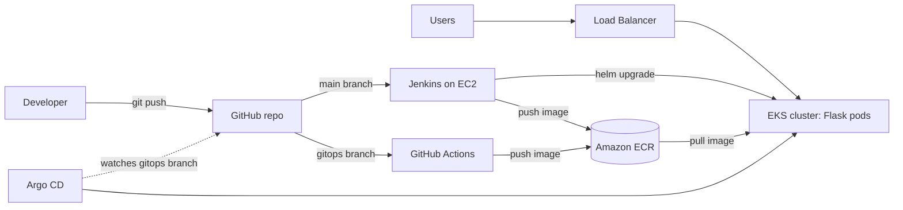

# Flask on AWS EKS: Terraform, Jenkins and GitOps

A Flask "Hello, World!" app deployed to Amazon EKS. Terraform builds the AWS infrastructure, Docker packages the app, and Helm defines the Kubernetes resources. Two deployment paths are included: **Jenkins** (`main` branch) and **GitHub Actions + Argo CD** (`gitops` branch).



## At a glance

| | |
| --- | --- |
| Region | `us-west-1` |
| EKS cluster | `tc2-eks` |
| ECR repository | `hello-world` |
| GitHub repository | `skysamuels-art/tech-2a-app` |
| App port | `5000` |
| Scaling | HPA: 1 to 12 pods. Node group: 1 to 4 nodes, starting at 2 |

## How it works

| Component | Role |
| --- | --- |
| Terraform | Creates the VPC (2 public and 2 private subnets, NAT gateway), EKS, ECR, IAM and the Jenkins EC2 instance |
| Helm | Templates the Deployment, Service, Ingress and HPA |
| ALB controller | Creates the public load balancer from the Ingress |
| Metrics Server | Feeds CPU metrics to the HPA |
| Jenkins (`main`) | Pulls the code, builds the image with Docker, pushes to ECR, deploys with Helm |
| GitHub Actions (`gitops`) | Builds and pushes the image, commits the new tag to `k8s/values.yaml` |
| Argo CD (`gitops`) | Syncs the Helm chart from Git to EKS |

## Prerequisites

- AWS account with CLI credentials configured
- Python, Git, Docker Desktop, Terraform, kubectl, Helm
- Commands run in PowerShell from the project root unless noted. Replace the account ID (`060255765406`) with your own.
- Commands marked **bash** run on the Jenkins EC2 instance (Linux), not on your workstation.

## Repository structure

| Path | Contents |
| --- | --- |
| `app.py`, `requirements.txt`, `Dockerfile` | Flask app and container |
| `infra/` | Terraform files (kept locally; no state or secrets in Git) |
| `k8s/` | Helm chart: `Chart.yaml`, `values.yaml`, `templates/` |
| `Jenkinsfile` | Jenkins pipeline (`main`) |
| `.github/workflows/` | GitHub Actions workflows (`gitops`) |
| `argocd/application.yaml` | Argo CD application definition |
| `images/` | Architecture diagram |

## Deployment

### 1. Test locally

```powershell
python -m pip install -r requirements.txt
python app.py
```

Stop with **Ctrl+C**, then test the container:

```powershell
docker build -t tech-2a-app .
docker run --rm -p 5000:5000 tech-2a-app
```

Open http://localhost:5000 and confirm **Hello, World!**

### 2. Provision infrastructure

```powershell
aws sts get-caller-identity
cd infra
terraform init
terraform validate
terraform plan
terraform apply
terraform output
cd ..
```

Review the plan before applying. Save the ECR URL, load balancer controller role ARN, VPC ID and Jenkins public IP.

### 3. Push the image to ECR

```powershell
aws ecr get-login-password --region us-west-1 | docker login --username AWS --password-stdin 060255765406.dkr.ecr.us-west-1.amazonaws.com
docker tag tech-2a-app:latest 060255765406.dkr.ecr.us-west-1.amazonaws.com/hello-world:latest
docker push 060255765406.dkr.ecr.us-west-1.amazonaws.com/hello-world:latest
```

### 4. Deploy with Helm

Set `image.repository` and `image.tag` in `k8s/values.yaml` to the pushed image.

```powershell
aws eks update-kubeconfig --region us-west-1 --name tc2-eks
kubectl get nodes
helm lint ./k8s
helm upgrade --install hello-world ./k8s --namespace default --wait --timeout 10m
kubectl rollout status deployment/hello-world
```

### 5. Enable public access and HPA metrics

Get the controller role and VPC ID:

```powershell
aws iam get-role --role-name tc2-eks-lb-controller --query Role.Arn --output text
aws eks describe-cluster --name tc2-eks --region us-west-1 --query cluster.resourcesVpcConfig.vpcId --output text
helm repo add eks https://aws.github.io/eks-charts
helm repo update
```

Install the ALB controller, replacing `YOUR_VPC_ID`:

```powershell
helm upgrade --install aws-load-balancer-controller eks/aws-load-balancer-controller -n kube-system --set clusterName=tc2-eks --set region=us-west-1 --set vpcId=YOUR_VPC_ID --set serviceAccount.create=true --set serviceAccount.name=aws-load-balancer-controller --set 'serviceAccount.annotations.eks\.amazonaws\.com/role-arn=arn:aws:iam::060255765406:role/tc2-eks-lb-controller'
kubectl rollout status deployment/aws-load-balancer-controller -n kube-system
kubectl get ingress hello-world
```

Open `http://` plus the Ingress **ADDRESS**. Then install Metrics Server:

```powershell
kubectl apply -f https://github.com/kubernetes-sigs/metrics-server/releases/latest/download/components.yaml
kubectl rollout status deployment/metrics-server -n kube-system
kubectl top pods
kubectl get hpa hello-world
```

## CI/CD

Use one deployment owner at a time: Jenkins **or** Argo CD. Disable the Jenkins deploy job before Argo CD manages the same app.

### 6. Jenkins (`main`)

Jenkins pulls the code from the repo, containerizes it with Docker, pushes the image to ECR, and triggers Helm to deploy the app into EKS. The steps below build that pipeline from a fresh Jenkins install.

#### 6.1 Run Jenkins on the EC2 instance

Run Jenkins in Docker on the Terraform-provisioned EC2 instance, with persistent `jenkins_home` and Docker engine access. Open `http://YOUR_JENKINS_IP:8080`, unlock Jenkins with the initial admin password, and install the **recommended plugins**.

#### 6.2 Install the required plugins

Go to **Manage Jenkins → Plugins → Available plugins** and install:

| Plugin | Note |
| --- | --- |
| Docker | |
| Amazon ECR | |
| Kubernetes CLI | |
| GitHub | Normally already installed with the recommended plugins |
| AWS Credentials | Normally already installed with the recommended plugins |
| Pipeline | Normally already installed with the recommended plugins |

Restart Jenkins if prompted.

#### 6.3 Install the CLI tools on Jenkins

Install **Helm CLI**, **AWS CLI** and **kubectl** on the Jenkins EC2 host. If Jenkins runs in a Docker container, the tools must be available **inside** the Jenkins container (bake them into the Jenkins image, or run these commands inside the container as root), because pipeline steps execute there.

**bash**

```bash
# Helm CLI
curl https://raw.githubusercontent.com/helm/helm/main/scripts/get-helm-3 | bash

# AWS CLI
curl "https://awscli.amazonaws.com/awscli-exe-linux-x86_64.zip" -o "awscliv2.zip"
unzip awscliv2.zip && sudo ./aws/install

# kubectl
curl -LO "https://dl.k8s.io/release/$(curl -L -s https://dl.k8s.io/release/stable.txt)/bin/linux/amd64/kubectl"
chmod +x kubectl
sudo mv kubectl /usr/local/bin/
```

Install `unzip` first if it is missing (`sudo apt-get update && sudo apt-get install -y unzip`). Also install the Docker CLI so the pipeline can run `docker build`.

Verify the installation:

```bash
aws --version
kubectl version --client
helm version
docker --version
```

#### 6.4 Add credentials

**GitHub personal access token (PAT)**

1. In GitHub go to **Settings → Developer Settings → Personal Access Tokens → Tokens (classic)**.
2. Click **Generate new token (classic)**.
3. Select these scopes:
   - `repo` (private repo access)
   - `admin:repo_hook` (webhook creation)
4. Copy the token.

**Add both credentials in Jenkins** under **Manage Jenkins → Credentials → (global) → Add Credentials**:

| Kind | Fields | ID | Description |
| --- | --- | --- | --- |
| Username with password | Username: your GitHub username. Password: the PAT | `github-read` | GitHub PAT for private repo access |
| AWS Credentials | Access Key ID and Secret Access Key | `tech2-aws` | AWS credentials for ECR and kubectl |

> The reference notes store the PAT as **Secret text** (ID `github-PAT-token`) and the AWS keys with ID `aws-credentials`. This project uses the IDs `github-read` and `tech2-aws` instead. Whatever IDs you choose, the `credentialsId` values in the `Jenkinsfile` must match them exactly.

Keep credentials out of Git.

#### 6.5 Add the GitHub webhook (in GitHub, not Jenkins)

In your GitHub repo go to **Settings → Webhooks → Add webhook**:

- **Payload URL:** `http://YOUR_JENKINS_IP:8080/github-webhook/`
- **Content type:** `application/json`
- **Events:** Just the push event

This triggers an automatic Jenkins build whenever code is pushed to GitHub. Use the current EC2 IP after any rebuild.

#### 6.6 Create the Jenkinsfile

Create the file in the project root:

```bash
touch Jenkinsfile
```

Place this pipeline script inside it:

```groovy
pipeline {
  agent any

  environment {
    ECR_REPO   = "060255765406.dkr.ecr.us-west-1.amazonaws.com/hello-world"
    IMAGE_TAG  = "${env.BUILD_ID}"
    AWS_REGION = "us-west-1"
    CLUSTER    = "tc2-eks"
  }

  stages {
    stage('Checkout') {
      steps {
        git branch: 'main',
            url: 'https://github.com/skysamuels-art/tech-2a-app.git',
            credentialsId: 'github-read'
      }
    }

    stage('Build Docker Image') {
      steps {
        sh 'docker build -t $ECR_REPO:$IMAGE_TAG .'
      }
    }

    stage('Push to ECR') {
      steps {
        withCredentials([[$class: 'AmazonWebServicesCredentialsBinding', credentialsId: 'tech2-aws']]) {
          sh '''
            aws ecr get-login-password --region $AWS_REGION | docker login --username AWS --password-stdin ${ECR_REPO%%/*}
            docker push $ECR_REPO:$IMAGE_TAG
          '''
        }
      }
    }

    stage('Deploy with Helm') {
      steps {
        withCredentials([[$class: 'AmazonWebServicesCredentialsBinding', credentialsId: 'tech2-aws']]) {
          sh '''
            aws eks update-kubeconfig --region $AWS_REGION --name $CLUSTER
            helm upgrade --install hello-world ./k8s \
              --namespace default \
              --set image.repository=$ECR_REPO \
              --set image.tag=$IMAGE_TAG \
              --wait --timeout 10m
          '''
        }
      }
    }
  }
}
```

What each stage does:

| Stage | Purpose |
| --- | --- |
| Checkout | Pulls the application code from the repo |
| Build Docker Image | Containerizes the app with Docker (the `Dockerfile` is in the repo root) |
| Push to ECR | Logs in to ECR and pushes the image tagged with the build ID |
| Deploy with Helm | Triggers Helm to deploy the app into EKS using the new tag |

#### 6.7 Upload the Jenkinsfile to your repo

```powershell
git add Jenkinsfile
git commit -m "Add Jenkins pipeline"
git push origin main
```

#### 6.8 Configure the pipeline job with SCM

1. In Jenkins click **New Item**, name it, and choose **Pipeline**.
2. Under **Build Triggers**, enable **GitHub hook trigger for GITScm polling**.
3. Under **Pipeline**, set **Definition** to **Pipeline script from SCM**.
4. **SCM:** Git. **Repository URL:** `https://github.com/skysamuels-art/tech-2a-app.git`. **Credentials:** `github-read`.
5. **Branch:** `*/main`. **Script Path:** `Jenkinsfile`.
6. Save.

#### 6.9 Allow Jenkins to deploy to EKS

Allow Jenkins to reach the EKS API on port 443 (cluster security group), and grant its AWS identity EKS deploy access (an EKS access entry or an `aws-auth` mapping for the IAM user or role behind `tech2-aws`).

#### 6.10 Run and troubleshoot

Click **Build Now** or push to `main`, then verify the build, ECR push, Helm deploy and rollout. If a stage fails, open **Console Output** and check these common causes:

- `docker: permission denied` or `command not found`: the Jenkins container lacks Docker engine access or the Docker CLI.
- `aws`, `kubectl` or `helm: command not found`: the tools from step 6.3 are not available where Jenkins runs the pipeline.
- ECR login or push fails: the `tech2-aws` credentials are wrong, or the region or account ID in `ECR_REPO` is wrong.
- `Unauthorized` or connection timeout from kubectl/Helm: step 6.9 is incomplete.
- Checkout fails: the `github-read` PAT is missing the `repo` scope.

### 7. GitHub Actions and Argo CD (`gitops`)

1. Create the `gitops` branch. Keep the Jenkins workflow on `main`.
2. Create the GitHub OIDC provider and an IAM role. Restrict the trust policy to this repository's `gitops` subject, audience `sts.amazonaws.com`, and grant ECR push permissions.
3. Add `.github/workflows/deploy.yml` to sign in through OIDC, build and push a uniquely tagged image, and commit the tag to `k8s/values.yaml`.
4. Install Argo CD in EKS and connect it to the repository (private repos need read credentials).
5. Point `argocd/application.yaml` at branch `gitops`, path `k8s`, namespace `default`, release `hello-world`. Enable automatic sync and let the HPA control replicas.

```powershell
kubectl apply -f argocd/application.yaml
kubectl get applications -n argocd
```

Test it: change the greeting in `app.py`, push to `gitops`, and confirm the Actions run succeeds, the tag changes in Git, and Argo CD shows **Synced and Healthy**.

### 8.
